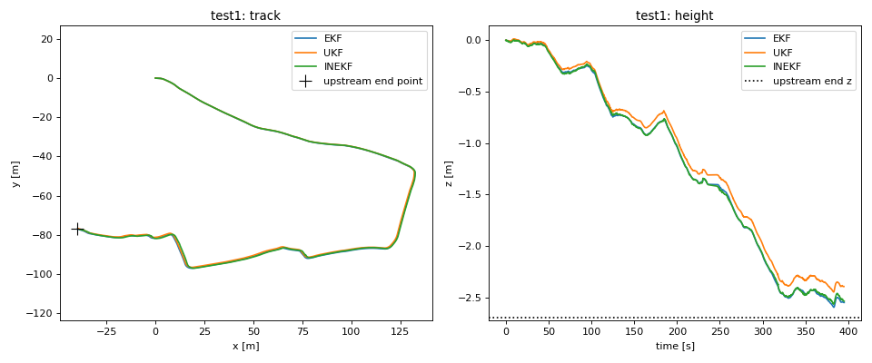
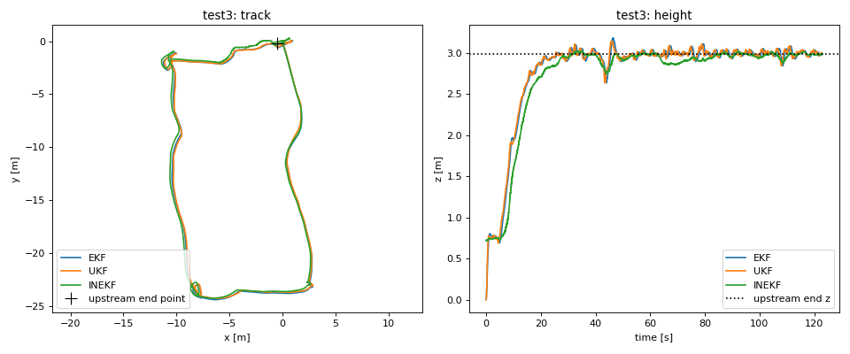

# EKF vs UKF vs InEKF

## test1

Upstream end point tolerance: 1.05 m.

| Filter | End error [m] | GNSS fit RMS [m] | Rate [Hz] | CPU [s] |
|---|---|---|---|---|
| EKF | 0.230 | 21.37 | 27 | 26.8 |
| UKF | 0.588 | 21.18 | 27 | 30.1 |
| INEKF | 1.554 | 21.19 | 30 | 20.2 |

| Pair | Position diff RMS / max [m] | Yaw diff RMS [deg] |
|---|---|---|
| EKF / UKF | 0.437 / 0.598 | 0.01 |
| EKF / INEKF | 0.848 / 1.410 | 2.90 |
| UKF / INEKF | 0.843 / 1.297 | 2.90 |

## test2

Upstream end point tolerance: 0.14 m.

| Filter | End error [m] | Rate [Hz] | CPU [s] |
|---|---|---|---|
| EKF | 0.011 | 47 | 4.6 |
| UKF | 0.066 | 48 | 6.1 |
| INEKF | 0.013 | 50 | 3.8 |

| Pair | Position diff RMS / max [m] | Yaw diff RMS [deg] |
|---|---|---|
| EKF / UKF | 0.039 / 0.072 | 0.01 |
| EKF / INEKF | 0.015 / 0.022 | 0.02 |
| UKF / INEKF | 0.033 / 0.068 | 0.02 |

## test3

Upstream end point tolerance: 0.13 m.

| Filter | End error [m] | Rate [Hz] | CPU [s] |
|---|---|---|---|
| EKF | 0.059 | 29 | 25.5 |
| UKF | 0.115 | 28 | 50.2 |
| INEKF | 0.271 | 181 | 10.8 |

| Pair | Position diff RMS / max [m] | Yaw diff RMS [deg] |
|---|---|---|
| EKF / UKF | 0.132 / 0.357 | 0.04 |
| EKF / INEKF | 0.298 / 0.721 | 0.99 |
| UKF / INEKF | 0.314 / 0.720 | 0.99 |

