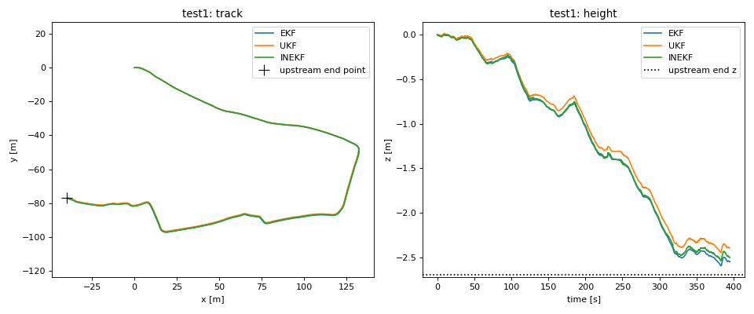
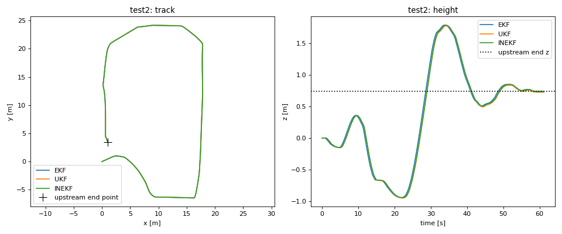
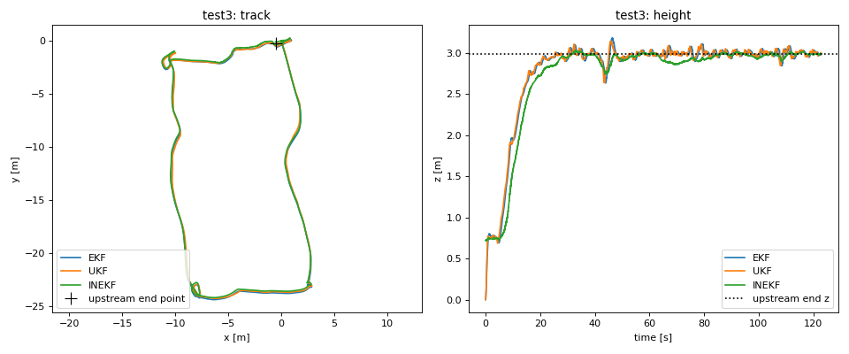
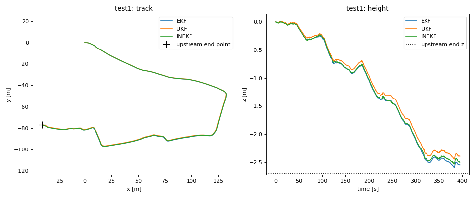
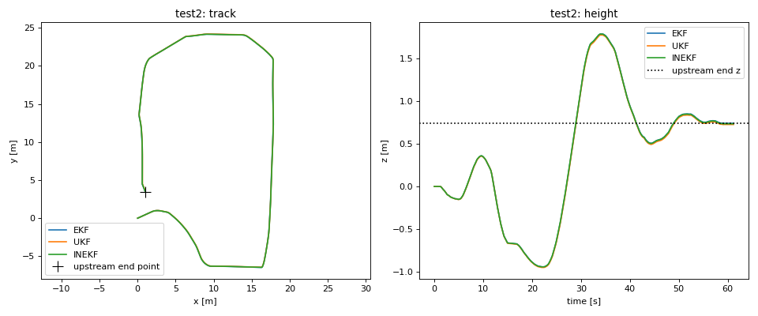
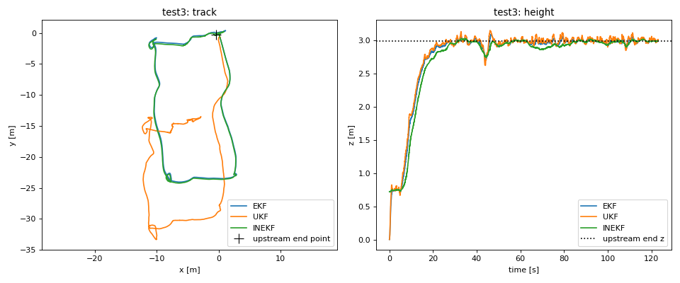

# EKF vs UKF vs InEKF

## Upstream sensors

EKF and UKF with the upstream bag configs, the InEKF with the IMU and the odometry velocity (and height on test3).

### test1

Upstream end point tolerance: 1.05 m.

| Filter | End error x / y / z [m] | End error [m] | GNSS drift at 100 / 200 / 300 s / end [m] | GNSS drift RMS [m] | Rate [Hz] | CPU [s] |
|---|---|---|---|---|---|---|
| EKF | +0.175 / -0.038 / +0.147 | 0.232 | 3.0 / 5.3 / 44.9 / 71.8 | 35.8 | 27 | 23.7 |
| UKF | +0.464 / +0.200 / +0.302 | 0.589 | 3.3 / 5.3 / 44.8 / 71.4 | 35.5 | 27 | 28.2 |
| INEKF | +0.280 / -0.179 / +0.192 | 0.384 | 3.0 / 5.1 / 44.8 / 71.9 | 35.8 | 30 | 19.9 |

| Pair | Diff RMS x / y / z [m] | Yaw diff RMS [deg] |
|---|---|---|
| EKF / UKF | 0.185 / 0.384 / 0.090 | 0.01 |
| EKF / INEKF | 0.155 / 0.111 / 0.022 | 0.78 |
| UKF / INEKF | 0.214 / 0.313 / 0.072 | 0.78 |

### test2

Upstream end point tolerance: 0.14 m.

| Filter | End error x / y / z [m] | End error [m] | Rate [Hz] | CPU [s] |
|---|---|---|---|---|
| EKF | -0.010 / +0.004 / -0.003 | 0.011 | 47 | 4.4 |
| UKF | +0.011 / +0.058 / -0.017 | 0.062 | 47 | 5.7 |
| INEKF | +0.011 / +0.002 / -0.008 | 0.013 | 50 | 3.4 |

| Pair | Diff RMS x / y / z [m] | Yaw diff RMS [deg] |
|---|---|---|
| EKF / UKF | 0.022 / 0.030 / 0.010 | 0.01 |
| EKF / INEKF | 0.015 / 0.009 / 0.002 | 0.01 |
| UKF / INEKF | 0.012 / 0.026 / 0.009 | 0.01 |

### test3

Upstream end point tolerance: 0.13 m.

| Filter | End error x / y / z [m] | End error [m] | Rate [Hz] | CPU [s] |
|---|---|---|---|---|
| EKF | +0.030 / -0.052 / +0.002 | 0.060 | 29 | 23.0 |
| UKF | +0.112 / -0.020 / +0.018 | 0.115 | 29 | 44.9 |
| INEKF | -0.092 / +0.113 / +0.004 | 0.145 | 181 | 10.2 |

| Pair | Diff RMS x / y / z [m] | Yaw diff RMS [deg] |
|---|---|---|
| EKF / UKF | 0.081 / 0.102 / 0.026 | 0.03 |
| EKF / INEKF | 0.058 / 0.160 / 0.127 | 0.34 |
| UKF / INEKF | 0.109 / 0.133 / 0.126 | 0.34 |

## Common sensors

All three fuse the same sensors: IMU orientation, rates and acceleration, odometry velocity (and height on test3).

### test1

Upstream end point tolerance: 1.05 m.

| Filter | End error x / y / z [m] | End error [m] | GNSS drift at 100 / 200 / 300 s / end [m] | GNSS drift RMS [m] | Rate [Hz] | CPU [s] |
|---|---|---|---|---|---|---|
| EKF | +0.170 / -0.037 / +0.150 | 0.229 | 3.0 / 5.3 / 44.9 / 71.8 | 35.8 | 27 | 25.7 |
| UKF | +0.529 / +0.178 / +0.306 | 0.636 | 2.9 / 5.1 / 44.4 / 71.4 | 35.5 | 27 | 28.4 |
| INEKF | +0.289 / -0.177 / +0.196 | 0.391 | 3.0 / 5.1 / 44.8 / 71.9 | 35.8 | 30 | 20.4 |

| Pair | Diff RMS x / y / z [m] | Yaw diff RMS [deg] |
|---|---|---|
| EKF / UKF | 0.192 / 0.367 / 0.089 | 0.01 |
| EKF / INEKF | 0.165 / 0.112 / 0.023 | 0.78 |
| UKF / INEKF | 0.183 / 0.295 / 0.071 | 0.78 |

### test2

Upstream end point tolerance: 0.14 m.

| Filter | End error x / y / z [m] | End error [m] | Rate [Hz] | CPU [s] |
|---|---|---|---|---|
| EKF | -0.009 / +0.004 / -0.003 | 0.011 | 48 | 4.2 |
| UKF | +0.014 / +0.061 / -0.017 | 0.065 | 48 | 5.8 |
| INEKF | +0.014 / +0.004 / -0.008 | 0.017 | 50 | 3.6 |

| Pair | Diff RMS x / y / z [m] | Yaw diff RMS [deg] |
|---|---|---|
| EKF / UKF | 0.022 / 0.031 / 0.010 | 0.01 |
| EKF / INEKF | 0.015 / 0.009 / 0.002 | 0.01 |
| UKF / INEKF | 0.012 / 0.027 / 0.009 | 0.01 |

### test3

Upstream end point tolerance: 0.13 m.

| Filter | End error x / y / z [m] | End error [m] | Rate [Hz] | CPU [s] |
|---|---|---|---|---|
| EKF | +0.183 / +0.275 / -0.001 | 0.331 | 29 | 24.1 |
| UKF | -4.602 / -13.813 / +0.024 | 14.560 | 28 | 49.4 |
| INEKF | -0.091 / +0.116 / +0.004 | 0.148 | 181 | 10.1 |

| Pair | Diff RMS x / y / z [m] | Yaw diff RMS [deg] |
|---|---|---|
| EKF / UKF | 2.401 / 9.726 / 0.042 | 0.03 |
| EKF / INEKF | 0.120 / 0.163 / 0.091 | 0.34 |
| UKF / INEKF | 2.295 / 9.581 / 0.123 | 0.34 |

