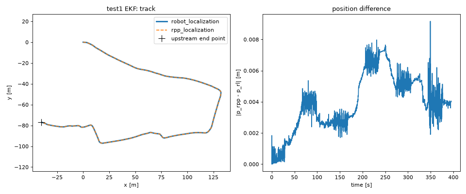
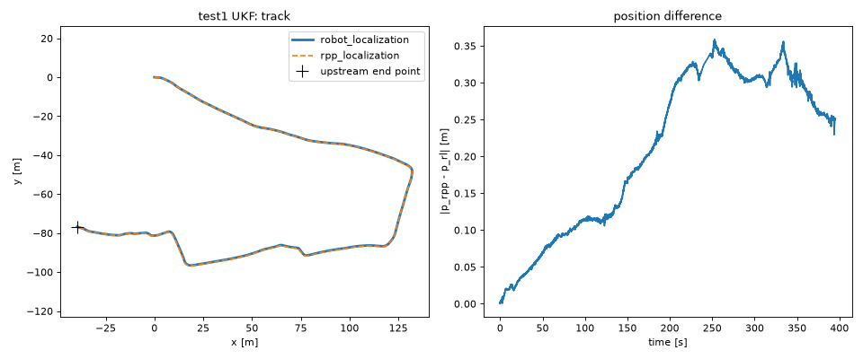
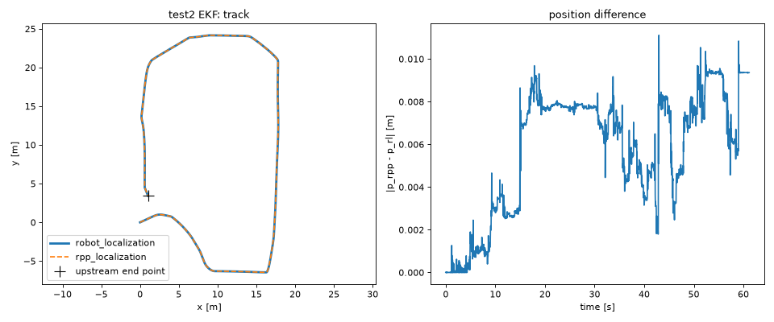
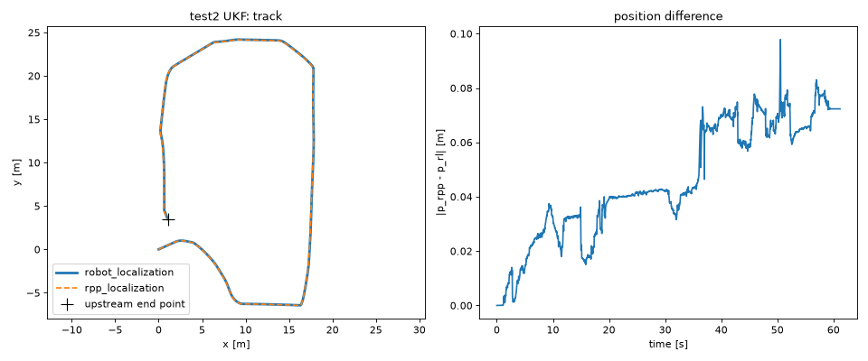
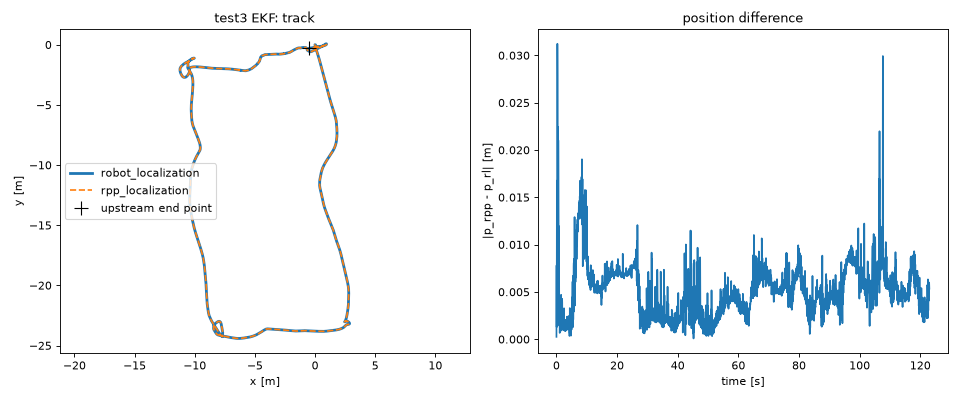
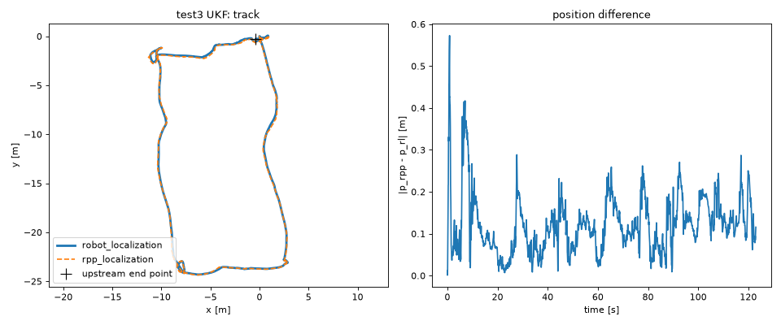
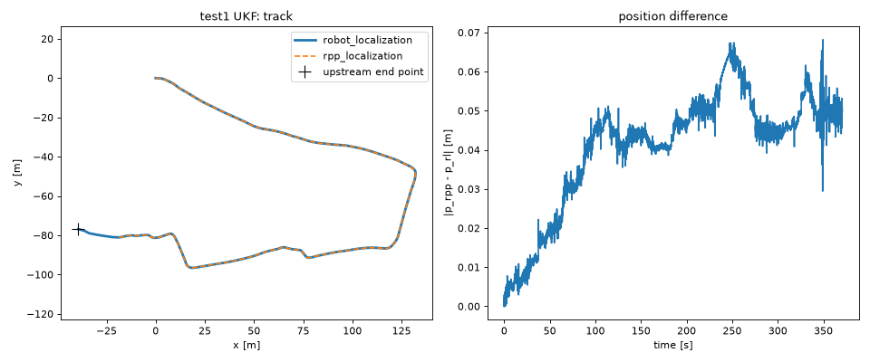
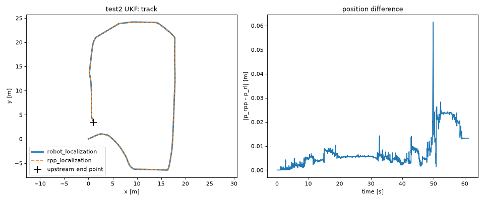
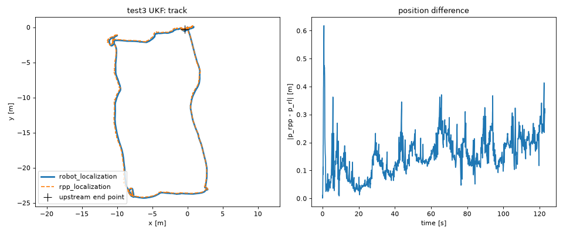

# rpp_localization vs robot_localization

## rpp_localization

robot_localization 3.11.0.

| Bag | Filter | End error RL / rpp (tol.) [m] | Pos. diff RMS [m] | Yaw diff RMS [deg] | Rate RL / rpp [Hz] | CPU RL / rpp [s] |
|---|---|---|---|---|---|---|
| test1 | EKF | 0.224 / 0.228 (1.05) | 0.0044 | 0.02 | 28 / 27 | 24 / 43 |
| test1 | UKF | 0.303 / 0.136 (1.29) | 0.2371 | 0.02 | 28 / 27 | 25 / 153 |
| test2 | EKF | 0.004 / 0.011 (0.14) | 0.0064 | 0.01 | 50 / 47 | 4 / 10 |
| test2 | UKF | 0.005 / 0.075 (0.24) | 0.0507 | 0.23 | 50 / 34 | 4 / 50 |
| test3 | EKF | 0.051 / 0.054 (0.13) | 0.0058 | 0.02 | 29 / 28 | 10 / 66 |
| test3 | UKF | 0.042 / 0.131 (0.17) | 0.1382 | 0.60 | 29 / 6 | 10 / 126 |

## rpp_localization, UKF with robot_localization's math

robot_localization 3.11.0.

| Bag | Filter | End error RL / rpp (tol.) [m] | Pos. diff RMS [m] | Yaw diff RMS [deg] | Rate RL / rpp [Hz] | CPU RL / rpp [s] |
|---|---|---|---|---|---|---|
| test1 | UKF | 0.310 / stopped (1.29) | 0.0436 | 0.02 | 28 / 26 | 24 / 0 |
| test2 | UKF | 0.004 / 0.016 (0.24) | 0.0103 | 0.11 | 50 / 38 | 4 / 51 |
| test3 | UKF | 0.042 / 0.190 (0.17) | 0.1700 | 0.61 | 29 / 6 | 11 / 127 |

stopped: rpp_localization exited before the bag ended.
